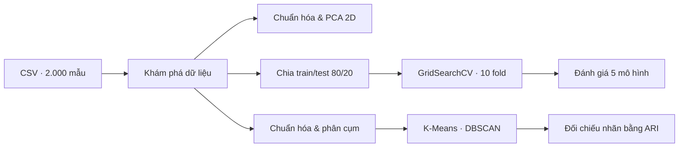

<div align="center">

# 📡 WiFi Room Classification

### Nhận diện phòng từ tín hiệu WiFi bằng Machine Learning

Phân tích **7 tín hiệu RSSI** để dự đoán **4 phòng** — từ khám phá dữ liệu đến đánh giá mô hình và phân cụm.


**[📓 Notebook](WiFi_Room_Classification_Project_Starter/notebooks/FINAL_WiFi_Classification%20%282%29.ipynb) · [📄 Báo cáo PDF](WiFi_Room_Classification_Project_Starter/reports/wifi_room_classification.pdf) · [🔎 Kiểm chứng](WiFi_Room_Classification_Project_Starter/reports/VERIFICATION.md)**

</div>

---

## Tổng quan

Mỗi vị trí trong nhà có thể tạo ra một mẫu cường độ tín hiệu WiFi khác nhau. Project khảo sát khả năng sử dụng mẫu tín hiệu đó để phân loại phòng, đồng thời kiểm tra xem các nhóm dữ liệu tự nhiên có tương ứng với nhãn phòng thực tế hay không.

| Dữ liệu | Đặc trưng | Nhãn | Đánh giá |
|:---:|:---:|:---:|:---:|
| **2.000 mẫu** | **7 RSSI** | **4 phòng** | **10-fold CV** |

**Đầu vào:** `WiFi_1` → `WiFi_7`, cường độ tín hiệu tính bằng dBm.  
**Đầu ra:** nhãn `Room ∈ {1, 2, 3, 4}`. Mỗi phòng có 500 mẫu.

## Quy trình thực nghiệm



- **Khám phá:** kiểm tra chất lượng CSV, phân bố nhãn, thống kê RSSI và tương quan.
- **Trực quan hóa:** PCA từ 7 chiều xuống 2 chiều, giữ khoảng **72,96% phương sai**.
- **Phân loại:** tối ưu KNN, Random Forest, Gaussian Naive Bayes, AdaBoost và SVM.
- **Phân cụm:** khảo sát K-Means và DBSCAN; so sánh cụm với nhãn phòng bằng ARI.

## Kết quả phân loại

Các mô hình dùng chung phép chia **1.600 mẫu train / 400 mẫu test**. Điểm CV là F1-macro trung bình trên 10 fold của tập train.

| Mô hình | CV F1-macro ↑ | Test Accuracy ↑ | Test F1-macro ↑ | Test Log Loss ↓ |
|---|---:|---:|---:|---:|
| KNN | 0,9844 | 98,50% | 0,9850 | **0,0319** |
| Random Forest | 0,9856 | 98,00% | 0,9801 | 0,0564 |
| Gaussian Naive Bayes | 0,9831 | 98,50% | 0,9850 | 0,0555 |
| AdaBoost | **0,9856** | 98,00% | 0,9801 | 1,1526 |
| SVM | 0,9832 | **98,75%** | **0,9875** | 0,0451 |

**SVM** dự đoán đúng 395/400 mẫu test. **KNN** có Log Loss thấp nhất. Theo điểm CV chưa làm tròn, **AdaBoost** đứng đầu với 0,985627754, nhỉnh hơn Random Forest khoảng 0,000006.

> Mô hình được chọn theo **train CV**, không theo thứ hạng test. Chênh lệch nhỏ trên một phép chia dữ liệu chưa đủ để khẳng định mô hình vượt trội có ý nghĩa thống kê.

## Kết quả phân cụm

| Thuật toán | Số cụm | Điểm nhiễu | ARI ↑ |
|---|---:|---:|---:|
| K-Means | 4 | 0 | **0,8182** |
| DBSCAN | 15 | 865 | 0,2904 |

K-Means tạo các cụm phù hợp với nhãn phòng hơn trong khảo sát này. DBSCAN trong bảng được chọn theo ARI trong 21 cấu hình, nên có tham chiếu nhãn khi chọn tham số. Notebook cũng bổ sung khảo sát chọn bằng Silhouette không dùng nhãn để làm rõ giới hạn của cách đánh giá.

## Chạy project

### Trên Google Colab

1. Mở [notebook thực nghiệm](WiFi_Room_Classification_Project_Starter/notebooks/FINAL_WiFi_Classification%20%282%29.ipynb) bằng Colab.
2. Upload [wifi_localization.csv](WiFi_Room_Classification_Project_Starter/data/wifi_localization.csv) vào `/content`, hoặc dùng đường dẫn Google Drive được cấu hình trong notebook.
3. Chọn **Runtime → Run all** để chạy từ đầu đến cuối.

### Trên máy cá nhân

```powershell
git clone https://github.com/ctus123/WiFi_classification.git
cd WiFi_classification/WiFi_Room_Classification_Project_Starter
python -m venv .venv
.\.venv\Scripts\Activate.ps1
python -m pip install -r requirements-reproducible.txt
```

Mở notebook bằng VS Code, chọn kernel `.venv` vừa tạo và chạy toàn bộ. Notebook tự tìm CSV khi mở từ thư mục project hoặc `notebooks/`; có thể đặt biến môi trường `WIFI_DATA_FILE` để dùng đường dẫn khác.

Để chạy kiểm chứng tự động và xuất báo cáo:

```powershell
python scripts/verify_and_export.py
python scripts/export_pdf.py
```

Script đầu chạy notebook từ kernel mới và xuất HTML. Script xuất PDF cần **Microsoft Edge**; Playwright đã có trong file thư viện tái lập.

## Cấu trúc repository

```text
WiFi_classification/
├── README.md
└── WiFi_Room_Classification_Project_Starter/
    ├── data/                         # CSV dữ liệu
    ├── docs/                         # Quy trình, thuật ngữ, rà soát thuật toán
    ├── notebooks/                    # Notebook chính và output thực nghiệm
    ├── reports/                      # PDF, HTML, bảng CSV và manifest
    ├── scripts/                      # Kiểm chứng và xuất báo cáo
    ├── requirements.txt              # Dải phiên bản thư viện
    └── requirements-reproducible.txt  # Phiên bản môi trường đã kiểm chứng
```

## Kiểm chứng và giới hạn

**47/47 ô code** đã chạy thành công từ kernel mới. Các kiểm tra bao gồm schema dữ liệu, giá trị hữu hạn, train/test không giao chỉ số, số fold, số đầu vào và xác suất dự đoán hợp lệ. Phiên bản thư viện cùng SHA-256 của CSV được ghi trong [run_manifest.json](WiFi_Room_Classification_Project_Starter/reports/run_manifest.json).

Scaler được fit trong từng fold qua Pipeline; PCA toàn dữ liệu chỉ dùng trực quan hóa. Nhãn phòng không tham gia bước tạo cụm. Kết quả phản ánh bộ dữ liệu hiện tại, chưa chứng minh khả năng áp dụng trực tiếp cho tòa nhà khác hoặc tín hiệu WiFi thời gian thực.

## Tài liệu dự án

| Tài liệu | Nội dung |
|---|---|
| [Tổng quan dự án](WiFi_Room_Classification_Project_Starter/docs/01_PROJECT_OVERVIEW.md) | Bài toán, mục tiêu và phạm vi |
| [Hướng dẫn dữ liệu](WiFi_Room_Classification_Project_Starter/docs/02_DATA_GUIDE.md) | Cấu trúc CSV và cách nạp dữ liệu |
| [Quy trình Machine Learning](WiFi_Room_Classification_Project_Starter/docs/03_ML_WORKFLOW.md) | Tiền xử lý, huấn luyện và đánh giá |
| [Checklist nộp bài](WiFi_Room_Classification_Project_Starter/docs/05_DELIVERABLES.md) | Các yêu cầu và sản phẩm cần nộp |
| [Thuật ngữ](WiFi_Room_Classification_Project_Starter/docs/06_GLOSSARY.md) | Các khái niệm sử dụng trong bài |
| [Rà soát thuật toán](WiFi_Room_Classification_Project_Starter/docs/07_ALGORITHM_REVIEW.md) | Giải thích tham số, logic và hướng dẫn bảo vệ |
| [Kết quả kiểm chứng](WiFi_Room_Classification_Project_Starter/reports/VERIFICATION.md) | Kết quả chạy lại và giới hạn kiểm chứng |

---

<div align="center">

**Nhóm 5** · Nguyễn Cẩm Tú · Đoàn Đình Điền · Nguyễn Khoa

*Phân tích và khai thác dữ liệu · WiFi Localization*

</div>
